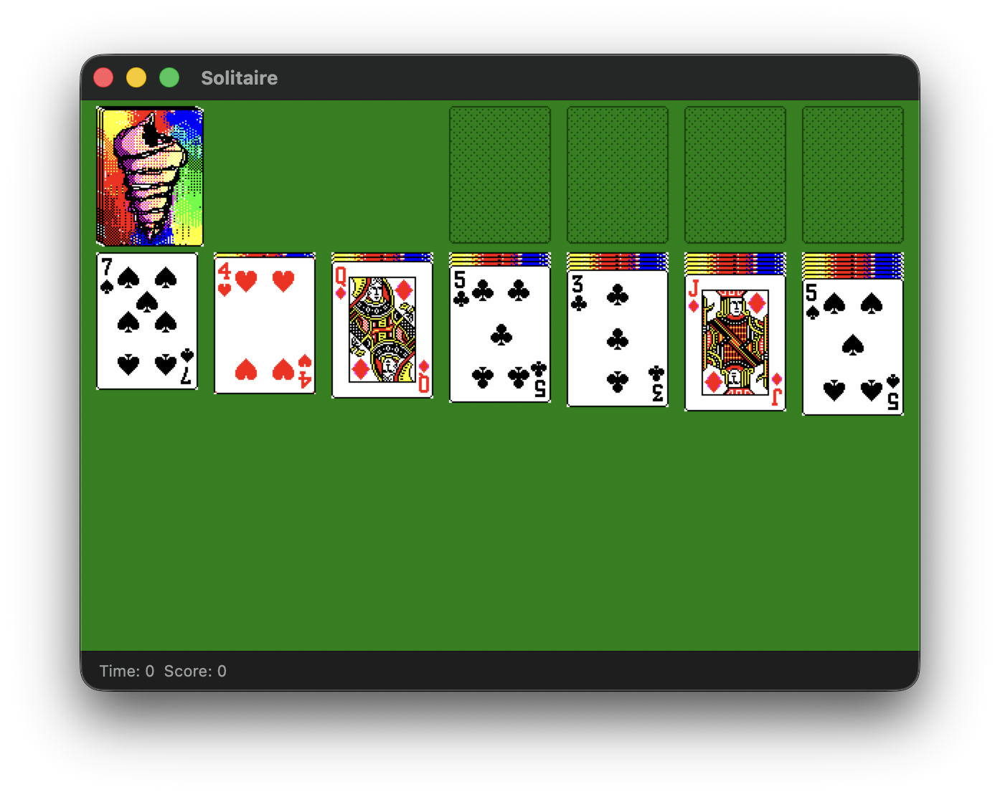
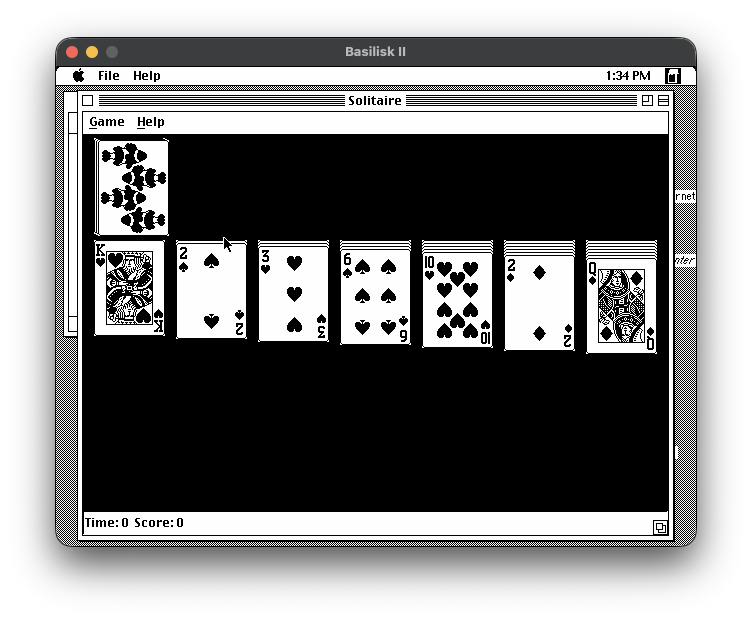
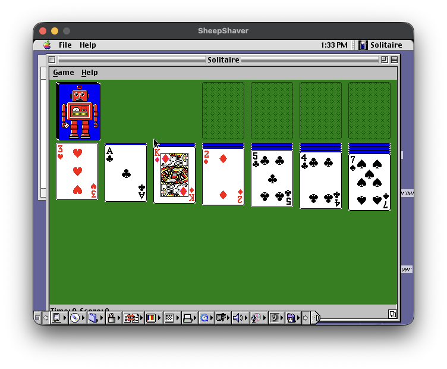
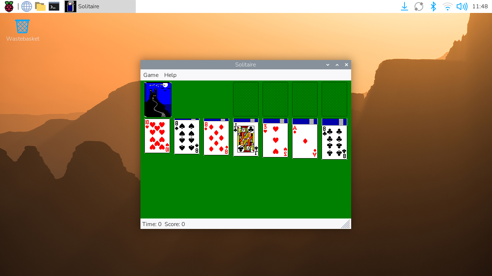
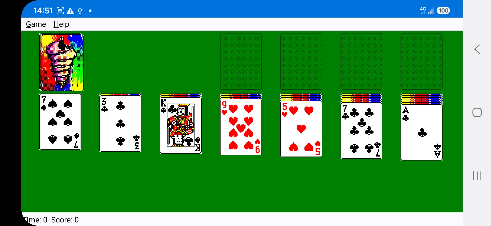

# wxSolitaire

A cross-platform implementation of classic Klondike Solitaire built with C++ and [wxWidgets](https://www.wxwidgets.org/). Runs on Windows, macOS, Linux, Android and classic Mac OS (68k and PowerPC).


## Screenshots

- Windows:


- macOS:



- Mac OS 7.5.X (m68k)



- Mac OS 9.X (ppc)



- Linux:



- Android:



## Features

- Classic Klondike solitaire gameplay
- Draw one or draw three card modes
- Scoring modes: Standard, Vegas, or None
- Timed game mode
- Undo support
- Drag-and-drop with outline or full bitmap dragging
- 12 card back designs
- Keyboard navigation

## Building

### Prerequisites

- C++11 compiler
- CMake 3.14+
- wxWidgets (core, base, xrc, xml, html components)

### Build steps

```sh
mkdir build && cd build
cmake ..
cmake --build .
```

On macOS this produces a `wxSolitaire.app` bundle. On Windows it builds a GUI executable with the application icon and manifest. On Linux it builds a standard executable.

### Android (arm64-v8a)

The Android build reuses the same C++ game code, compiled against the wxWidgets
**Qt port (wxQt)** that ships prebuilt inside the Qt 6.9.3 Android kit, and is
packaged into an APK with `androiddeployqt`.

Prerequisites:

- Qt 6.9.3 Android kit at `/usr/local/qt-6.9.3-android-arm64` (with the wxQt
  static libraries) and the host Qt at `/usr/local/qt-6.9.3`
- Android SDK (with a build-tools + platform) and NDK, JDK 17+
- Host `wxrc-3.3` (used to compile the card resources on the build machine)

Build and package a signed release APK:

```sh
cp android-signing.env.example android-signing.env   # then fill in your keystore
./build-android.sh
```

`build-android.sh` runs `qt-cmake`, builds `libwxSolitaire_arm64-v8a.so`, and
invokes the Qt `apk` target (which calls `androiddeployqt`). Signing uses your
existing keystore via the `QT_ANDROID_KEYSTORE_*` variables in
`android-signing.env`; without them the APK is left unsigned. The resulting APK
is printed at the end of the run (under `build-android/.../outputs/apk/`).

### Classic Mac OS (68k and PowerPC)

Built with the [Retro68](https://github.com/autc04/Retro68) toolchain
(installed in `/opt/retro68`) and its wxRetro68 port of wxWidgets, plus a host
`wxrc`:

```sh
retro68/build.sh            # or: RETRO68=/path/to/retro68 retro68/build.sh out-dir
```

This builds the 68k and PowerPC applications and merges them into a single
fat application, `build-retro68/Solitaire.dsk` (an HFS disk image for
Basilisk II, SheepShaver, QEMU or a real Mac) and `build-retro68/Solitaire.bin`
(MacBinary). It needs System 7 or later with 32-bit QuickDraw. The help is
built in and shown in its own window. The classic Mac icons in
`retro68/icons.r` are generated from `sizes/` by `retro68/make-icons.py`.

To test unattended in Basilisk II, build with tracing and run it from a copy
of a System 7/8 boot disk (`BOOT_DISK`, default `~/MacROM/HD.img`; the
original is not modified):

```sh
SOLITAIRE_CMAKE_ARGS=-DSOLITAIRE_TRACE=ON retro68/build.sh build-trace
retro68/run-basilisk.sh build-trace/m68k/Solitaire.bin
```

The trace build logs its startup to `wxtest.log` and shuts the Mac down 25
seconds after its window appears; the script prints the log and keeps
screenshots in its work directory.

## Installing

After building, install with:

```sh
cmake --install .
```

On Linux the install includes a `.desktop` file and AppStream metadata for integration with desktop environments and software centres.

## License

This project is licensed under the [GNU General Public License v2.0](https://www.gnu.org/licenses/old-licenses/gpl-2.0.html).

The `bin2c.c` utility is licensed under the BSD 2-Clause license (copyright Rafael Kitover, 2016).
